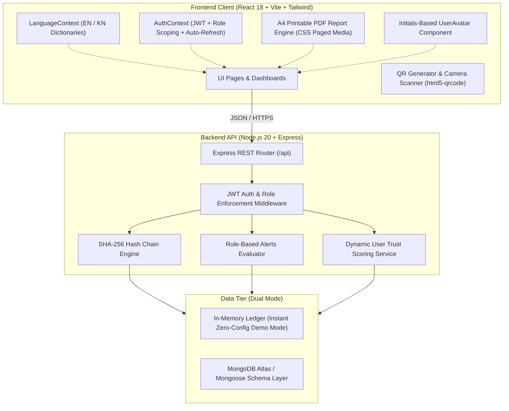

# CatchTrace — Technical Requirements Document (TRD)

**Project Name:** CatchTrace (Cryptographic Fish Supply Chain Traceability Platform)  
**Team:** Sea Sentinels  
**Hackathon / Event:** LEAP Hackathon Mangaluru (28–29 October 2026)  
**Problem Statement:** Problem Statement 6 — Fragmented Digital Records Across the Fish Supply Chain  
**Document Version:** 2.1 (Updated to reflect latest production features, audit reports, dispute workflows, and pitch-ready interface)  
**Status:** Implemented, Production-Grade & Verified  

---

## 1. System Architecture

CatchTrace is engineered as a decoupled client-server architecture with an append-only cryptographic event log, two-party handover confirmation, and an automated rules-based alerts engine.



---

## 2. Technology Stack

### 2.1 Client Layer
- **Core Framework:** React 18 with Vite (sub-second HMR and production bundle optimization).
- **Styling & Design System:** Tailwind CSS with coastal enterprise palette (Ocean Blue, Deep Navy, Seafoam Emerald, Alert Amber).
- **Print Optimization:** CSS Paged Media standards (`@page { size: A4 portrait; margin: 10mm 12mm; }`, `-webkit-print-color-adjust: exact !important`) powering clean PDF reports.
- **Icons & Visuals:** `lucide-react` enterprise vector icon library.
- **Charts & Data Visualization:** `recharts` for responsive volume-by-species and KPI trend distribution.
- **Hardware Integration:** `html5-qrcode` for multi-platform camera QR scanning (rear mobile camera and desktop webcam).
- **QR Generation:** `qrcode.react` (`QRCodeSVG` & Canvas) for vector QR rendering.
- **User Avatars:** Dynamic initials generator (`UserAvatar.jsx`) with role-based gradient backgrounds (zero third-party image host dependencies).
- **Notifications & Feedback:** `react-hot-toast` for dockside toast notifications; `canvas-confetti` for celebratory milestones.
- **Internationalization:** High-performance `LanguageContext` consuming nested JSON dictionaries (`en.json` and `kn.json`).

### 2.2 Server Layer
- **Runtime:** Node.js 20 LTS.
- **HTTP Engine:** Express 4.x with CORS, JSON body parser, and request logging.
- **Cryptographic Engine:** Node.js native `crypto` module (SHA-256 hashing).
- **Security & Password Hashing:** `bcryptjs` for one-way PIN hashing (`10` salt rounds); `jsonwebtoken` (JWT) for stateless bearer authentication.
- **Validation:** Request body parsing and sanitization with strict data constraints.

### 2.3 Data Storage Layer
- **Dual Compatibility:**
  1. *In-Memory Operational Mode:* Instant, zero-config startup pre-seeded with 29+ batches and alerts across Karnataka harbours.
  2. *MongoDB / Mongoose Schemas:* Production-ready document schemas with unique compound indexes.

---

## 3. Data Models & Database Schemas

### 3.1 User Model (`users`)
```json
{
  "_id": "usr_fisher_01",
  "name": "Ramesh Naik",
  "role": "FISHER", 
  "org_name": "Sea Queen Trawlers",
  "location": "Mangaluru Harbour",
  "email": "ramesh.fisher@gmail.com",
  "pin_hash": "$2a$10$e8wZ...",
  "confirmed_count": 14,
  "disputed_count": 1,
  "trust_score": 93.3,
  "created_at": "2026-10-28T04:30:00.000Z"
}
```
*Note on `trust_score`: Computed dynamically on read as `confirmed_count / (confirmed_count + disputed_count) * 100`, defaulting to `100` when both counts are `0`.*

### 3.2 Batch Model (`batches`)
```json
{
  "_id": "671e...",
  "batch_id": "FB-20261028-0001",
  "species": "Mackerel",
  "landing_centre": "Mangaluru Harbour",
  "landed_at": "2026-10-28T05:15:00.000Z",
  "initial_weight_kg": 250.0,
  "current_weight_kg": 185.0,
  "created_by": "usr_fisher_01",
  "created_by_name": "Ramesh Naik",
  "status": "ACTIVE",
  "notes": "Grade-A ocean catch, iced in forward hold",
  "qr_url": "https://catchtrace.in/trace/FB-20261028-0001",
  "created_at": "2026-10-28T05:20:00.000Z"
}
```
*Lifecycle Statuses:* `ACTIVE` (in transit/processing), `SOLD` (retail sale complete, closed), `FLAGGED` (rule anomaly detected).

### 3.3 Event Model (`events` — Append-Only Ledger)
```json
{
  "_id": "evt_001",
  "batch_id": "FB-20261028-0001",
  "seq": 1,
  "event_type": "LANDING",
  "title": "Catch Landed at Harbour",
  "actor_id": "usr_fisher_01",
  "actor_name": "Ramesh Naik",
  "org_name": "Sea Queen Trawlers",
  "location": "Mangaluru Harbour (ಬಂದರು)",
  "weight_kg": 250.0,
  "temp_c": 1.5,
  "price_per_kg": null,
  "yield_percent": null,
  "notes": "Landed by Trawler Sea Queen III",
  "grade_claimed": "A",
  "grade_confirmed": "A",
  "confirmation_status": "CONFIRMED",
  "confirmed_by": "usr_trader_01",
  "confirmed_at": "2026-10-28T10:15:00.000Z",
  "dispute_note": null,
  "photo_url": null,
  "occurred_at": "2026-10-28T05:15:00.000Z",
  "recorded_at": "2026-10-28T05:20:00.000Z",
  "prev_hash": "GENESIS",
  "hash": "8f3b499e12c4..."
}
```
*Confirmation Status Enum:* `PENDING` (awaiting receiver check), `CONFIRMED` (handover accepted), `DISPUTED` (audit discrepancy raised).

### 3.4 Alert Model (`alerts`)
```json
{
  "_id": "alt_001",
  "batch_id": "FB-20261028-0003",
  "event_id": "evt_012",
  "type": "COLD_CHAIN",
  "typeLabel": "Cold Chain Breach",
  "severity": "HIGH",
  "description": "Reefer transport temperature logged at 6.8°C (threshold: <= 4.0°C).",
  "resolved": false,
  "resolution_note": null,
  "time": "15 mins ago",
  "created_at": "2026-10-28T08:00:00.000Z"
}
```

---

## 4. Cryptographic Hash Chain Engine

### 4.1 Hashing Algorithm
Every handover event computes a SHA-256 hash across canonical serialized fields. Modifying any past event invalidates all downstream hashes:

$$\text{CanonicalString} = \text{batch\_id} + \text{"|"} + \text{seq} + \text{"|"} + \text{event\_type} + \text{"|"} + \text{actor\_id} + \text{"|"} + \text{weight\_kg} + \text{"|"} + \text{occurred\_at} + \text{"|"} + (\text{notes} \parallel \text{""}) + \text{"|"} + \text{prev\_hash}$$

$$\text{hash} = \text{SHA-256}(\text{CanonicalString})$$

### 4.2 Genesis & Chaining Rules
1. **Genesis Node:** Step #1 (`seq: 1`, `LANDING`) always uses `prev_hash = "GENESIS"`.
2. **Successive Nodes:** Step $N$ enforces `event[N].prev_hash === event[N-1].hash`.
3. **Immutability:** No `UPDATE` or `DELETE` API operations exist for the `events` collection. Corrections are logged as supplementary audit events.

### 4.3 On-Demand Verification Endpoint (`GET /api/batches/:id/verify`)
1. Fetches all events for `:id` ordered strictly by `seq ASC`.
2. Re-computes the expected SHA-256 hash for each step.
3. Compares expected hash with recorded `hash` and validates `prev_hash` integrity.
4. Returns:
```json
{
  "isValid": true,
  "batch_id": "FB-20261028-0001",
  "totalSteps": 5,
  "verifiedAt": "2026-10-29T08:00:00.000Z",
  "lastHash": "b3e94a...",
  "brokenStep": null
}
```
If tampered, returns `isValid: false`, identifying the exact sequence number, event title, and discrepancy reason.

---

## 5. Automated Rules-Based Alerts Engine

Evaluated synchronously on every new event insertion:

| Rule ID | Anomaly Check | Threshold / Logic | Severity |
| :--- | :--- | :--- | :--- |
| **`DUPLICATE`** | Duplicate Handover Entry | Same `batch_id` + same `event_type` + same `actor_id` logged within $\le 5\text{ minutes}$. | `MED` |
| **`WEIGHT_LOSS`** | Unexplained Transit Loss | Weight drop $> 15\%$ between non-processing steps. | `HIGH` |
| **`YIELD_ANOMALY`** | Processing Discrepancy | Filleting/processing yield $< 35\%$ or $> 85\%$. | `MED` |
| **`COLD_CHAIN`** | Temperature Excursion | Logged storage/transit temperature $> +4.0^\circ\text{C}$. | `HIGH` |
| **`TIME_GAP`** | Unreasonable Delay | Gap between consecutive handover steps $> 6\text{ hours}$. | `LOW` |
| **`MISSING_STEP`** | Out-of-Order Lifecycle | `SALE` attempted without prior `TRANSPORT` or `PURCHASE`. | `HIGH` |
| **`INTEGRITY`** | Broken Hash Link | Recomputed hash does not match stored hash. | `HIGH` |
| **`INTEGRITY_DISPUTE`**| Counterparty Handover Dispute | Receiving actor rejected handover due to damaged grade, spoiled cold-chain, or quantity mismatch. | `HIGH` |

---

## 6. REST API Interface

### 6.1 Authentication Endpoints
- `POST /api/auth/login`: Authenticates with `email` and 4-digit `pin`. Returns JWT token and sanitized user profile.
- `POST /api/auth/register`: Creates new operator account. Validates unique email, role, and organization.
- `GET /api/auth/me`: Returns current session user using Bearer token.

### 6.2 Batches Endpoints
- `GET /api/batches`: Lists batches with search and filtering (`species`, `status`, `centre`, `search`, `scope`).
  - `scope=my`: Scopes strictly to current authenticated user's organization.
  - `scope=all`: Permitted for `ADMIN` role for statewide audit.
- `GET /api/batches/:id`: Returns batch metadata, chronological events list, and active alerts.
- `POST /api/batches`: Creates new batch (restricted to `FISHER` and `ADMIN`). Automatically creates `seq: 1` `LANDING` event.
- `GET /api/batches/:id/verify`: Executes live SHA-256 chain audit and returns integrity report.
- `GET /api/batches/:id/certificate`: Returns official custody certificate if `batch.status === 'SOLD'` and zero `DISPUTED` events exist. Otherwise returns 404 with error message.

### 6.3 Handover Confirmation & Dispute Endpoints
- `POST /api/batches/:id/events/:eventId/confirm`: Confirms handover step.
  - Protected: JWT Bearer required; checks receiving actor eligibility.
  - Body: `{ grade_confirmed? }`.
  - Action: Sets `confirmation_status = CONFIRMED`, `confirmed_by = req.user.id`, `confirmed_at = now`. Increments logging actor's `confirmed_count`.
- `POST /api/batches/:id/events/:eventId/dispute`: Disputes handover step.
  - Protected: JWT Bearer required; checks receiving actor eligibility.
  - Body: `{ dispute_note, photo_url?, grade_confirmed? }`.
  - Action: Sets `confirmation_status = DISPUTED`, `confirmed_by = req.user.id`, `confirmed_at = now`, increments logging actor's `disputed_count`, and creates an `INTEGRITY_DISPUTE` alert (`HIGH` severity).

### 6.4 User Reputation & Trust Endpoints
- `GET /api/users/:id/trust-score`: Computes dynamic trust score:
  $$\text{trust\_score} = \frac{\text{confirmed\_count}}{\text{confirmed\_count} + \text{disputed\_count}} \times 100$$
  Returns `{ user_id, trust_score, confirmed_count, disputed_count }`.

### 6.5 Events Endpoints
- `POST /api/batches/:id/events`: Appends new handover event with claimed quality grade (`grade_claimed`). Enforces role permissions, updates `current_weight_kg`, computes SHA-256 hash, and triggers the alerts engine.

### 6.6 Public Consumer Endpoint & Privacy Filtering
- `GET /api/public/trace/:id`: Zero-authentication endpoint returning consumer-safe product provenance, authentic catch seal, and complete timeline.
- **Privacy Rule:** Sanitized via `serializeEventForViewer(event, viewerUser)`. Excludes `price_per_kg` and private counterparty identity/contact fields from public/unauthenticated viewers, while preserving them for `ADMIN` and direct parties to the transaction.

### 6.7 Supervisory & Reporting Endpoints
- `GET /api/dashboard/summary`: Aggregates volume by species, role-specific metrics, and delivery integrity rates.
- `GET /api/alerts`: Lists open or resolved alerts with optional severity filters.
- `PATCH /api/alerts/:id`: Resolves an alert with an audited operator resolution note.
- `POST /api/demo/reset`: Restores the initial seed state of 29 mock batches and alerts for demonstration purposes.

---

## 7. Official Printable A4 PDF Report Engine

### 7.1 Separation of Interactive & Print Media
To ensure clean exports without web chrome (navbars, search bars, interactive tabs), CatchTrace implements dual-mode document rendering:
- Web UI is marked with Tailwind class `print:hidden`.
- Dedicated Printable Report element is marked with `hidden print:block`.
- Global stylesheet rule:
  ```css
  @media print {
    @page {
      size: A4 portrait;
      margin: 10mm 12mm;
    }
    body {
      -webkit-print-color-adjust: exact !important;
      print-color-adjust: exact !important;
      background: white !important;
    }
  }
  ```

### 7.2 Printable Document Structure
1. **Header Block:** Official CatchTrace emblem, ISO compliance metadata, regulatory authority accreditation (*Karnataka Coastal Fisheries*).
2. **Batch Specification Grid:** Batch ID, Marine Species, Landing Harbour, Landing Date/Time, Vessel/Boat Name, Catch Weight.
3. **Cryptographic Provenance Card:** Certified SHA-256 Genesis Hash and terminal chain verification hash.
4. **Complete Chronological Handover Table:** Columns for Step (`#`), Stage/Event, Date & Time, Organization / Actor, Weight (kg), Temp (°C), Verification Status.
5. **High-Resolution QR Code & Signoff:** Vector `QRCodeSVG` tag for instant smartphone verification alongside an official inspector seal/signature line.

---

## 8. Internationalization (i18n) Engine

### 8.1 Architecture
The application implements an ultra-responsive client-side translation framework:
- Dictionaries: `client/src/locales/en.json` and `client/src/locales/kn.json`.
- State Management: `LanguageContext.jsx` with `t(path, fallback)` nested path resolver.
- Persistence: Stored in `localStorage` (`catchtrace_lang`).
- Global Switcher: Available on all headers and navbars with one-click toggling.

### 8.2 Dictionary Structure (22 Parallel Sections)
```
├── brand           (Taglines, branding)
├── nav             (Links, badges, notifications)
├── roles           (Fisher, Trader, Processor, Transporter, Seller, Admin)
├── species         (Mackerel, Sardine, Pomfret, Tuna, Prawns)
├── harbours        (Mangaluru, Malpe, Karwar, Baikampady, Bengaluru)
├── status          (Active, Sold, Flagged)
├── severity        (High, Medium, Low)
├── actions         (Create, Scan, Trace, Reset, Cancel, Resolve)
├── home            (Hero, Trust guarantees, 5-stage visual journey, 3-step guide)
├── dashboard       (Filters, KPI cards, Species volume chart, Guidelines)
├── batches         (Table headers, search placeholders, empty states)
├── batchDetails    (Tabs, weight progression, tamper alerts, exports)
├── newBatch        (Harbour forms, vessel inputs, live preview)
├── addEvent        (Role tabs, weight checkpoint, temperature logger)
├── scan            (Camera instructions, manual lookup)
├── alerts          (Alert table, filter tabs, resolution modal)
├── reports         (Species breakdowns, ESG compliance summary)
├── profile         (User credentials, session status, account switcher)
├── settings        (Language preference buttons, system toggles)
├── publicTrace     (Authenticity certificates, consumer transparency)
├── auth            (Email, PIN, login/register forms, help modals)
└── footer          (Coastal fisheries descriptions, compliance links)
```

---

## 9. Role-Based Access Control (RBAC) & Security

1. **Authorization Middleware:** Verifies JWT token and asserts authorized role before permitting mutating actions:
   - Only `FISHER` / `ADMIN` can call `POST /api/batches`.
   - Only `TRADER` / `ADMIN` can log `PURCHASE`.
   - Only `PROCESSOR` / `ADMIN` can log `PROCESSING`.
   - Only `TRANSPORTER` / `ADMIN` can log `TRANSPORT_*`.
   - Only `SELLER` / `ADMIN` can log `SALE`.
2. **Dashboard Isolation:** The server dynamically calculates statistics filtered by the caller's registered organization, preventing unauthorized cross-vessel data exposure.
3. **Public Data Sanitization:** The public endpoint strips internal trade secrets (e.g., auction purchase prices, operator contact numbers).

---

## 10. Deployment & Verification Guide

### 10.1 Local Development
```bash
# 1. Install dependencies
npm --prefix server install
npm --prefix client install

# 2. Run Backend API (Port 5000)
npm --prefix server start

# 3. Run Frontend Client (Port 5173)
npm --prefix client run dev -- --host 0.0.0.0 --port 5173
```

### 10.2 Verification Checklist
- [x] Backend responds on `http://localhost:5000/api/dashboard/summary`.
- [x] Frontend runs on `http://localhost:5173/`.
- [x] Clicking `🌐 ಕನ್ನಡ` dynamically translates all visible UI into authentic coastal Kannada.
- [x] Batch creation generates valid sequential ID and printable QR code.
- [x] Public trace route `/trace/FB-20261028-0001` renders unbroken SHA-256 timeline without requiring login.
- [x] Handover dispute modal logs dispute, updates trust scores, and raises `INTEGRITY_DISPUTE` alert.
- [x] Print / PDF export on `/batches/:id` outputs clean A4 official audit report without web UI elements.
- [x] Profile page displays initials avatar and "Sign Out & Switch Account" button routing smoothly to `/login`.
